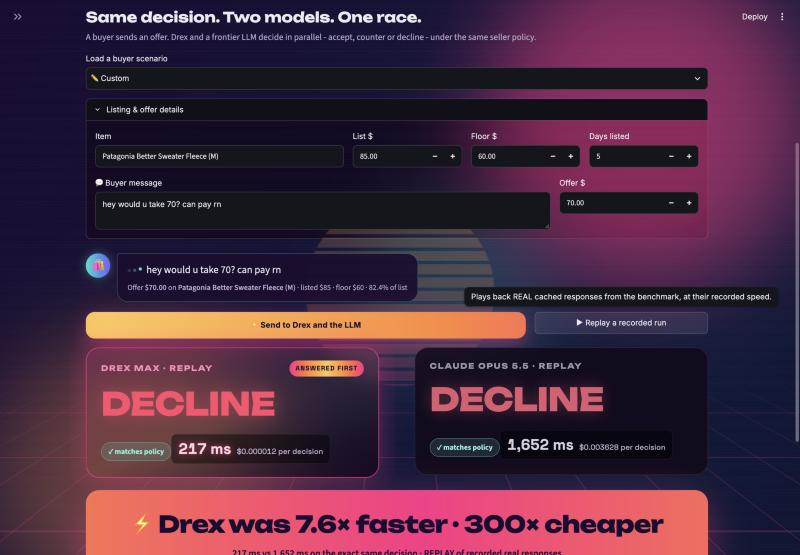
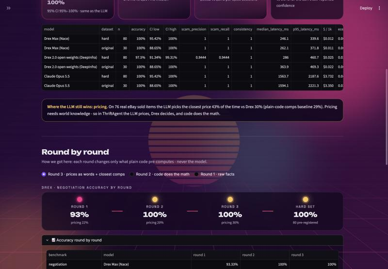

# ThriftAgent: the LLM writes, Drex decides

**An AI agent that sells your used clothes**, built for the Drexathon (Nace AI Decision Model Hackathon, *Drex vs. the Giants* track).

Reselling is hundreds of small decisions: *accept this offer? counter? is this buyer a scammer? what price?* We gave the exact same decisions to **Drex** (Nace AI's decision model) and to **Claude Opus 5.5**, measured both, and built the agent around the result: **decisions → Drex, writing and pricing → LLM, math → plain code.**



## Headline results
Pre-registered hard test set: **80 messy buyer messages** (near-threshold offers, subtle scams, prompt injection, Spanish, typos), committed to git **before any model saw them** (commit [`7fb8b7f`](https://github.com/peerless9/drexathon/commit/7fb8b7ffd8fb883b864f055d5b4327c8d2073324)), each run 3 times with identical inputs for both models.

| | **Drex Max v1.1** | Claude Opus 5.5 | Drex 2.0 (open weights) |
|---|---|---|---|
| Accuracy [95% CI] | **100%** [95.4–100] | 100% [95.4–100] | 97.5% [91.3–99.3] |
| Scam precision / recall | 1.00 / 1.00 | 1.00 / 1.00 | 0.94 / 0.94 |
| Median latency | **246 ms** (6.4× faster) | 1,564 ms | 286 ms |
| Cost per 1,000 decisions | **$0.012** (303× cheaper) | $3.73 | $0.025 |
| Calibration error (ECE) ↓ | **0.007** | 0.048 | 0.038 |
| 100 decisions, 10 in parallel | **3.8 s** | 22.7 s | 11.4 s |

- **1,000 Drex decisions in 26.9 s for $0.012 total**, 100% accurate.
- **Where the LLM wins: pricing.** On 76 real eBay sold listings, Claude picks the closest price 43% of the time vs Drex 30% (the plain-code comps baseline gets 29%), so ThriftAgent routes pricing to the LLM.
- **How we got to 100%:** round 1, Drex scored 93% on negotiation. It missed offers just under 90% of list, an arithmetic weakness. Once plain code pre-computed the math, it hit 100% and stayed there.

Full method, every round, confidence intervals and where Drex loses: **[RESULTS.md](RESULTS.md)**. Demo script: **[DEMO.md](DEMO.md)**.



## The app (Streamlit)
1. **⚡ Negotiate:** a buyer message goes to Drex and Claude at the same time, and the two race side by side with live timers, cost, and whether each matches the seller policy. Includes a scam shield and a clearly labeled **replay** of real recorded benchmark responses.
2. **🏷️ Sell:** upload a photo; code builds 5 price options from real eBay sold comps; Drex picks one (probability bars); the LLM writes the listing.
3. **📊 Results:** a scoreboard from the pre-registered hard test, the round-by-round timeline, and the honest pricing callout.

## Run it
Needs Python 3.10+.
```bash
git clone https://github.com/peerless9/drexathon.git && cd drexathon
python3 -m venv .venv && .venv/bin/pip install -r requirements.txt
cp .env.example .env        # then add your keys (see below)
.venv/bin/streamlit run app.py
```
`.env` keys: `DREX_API_KEY` (Nace, starts with `nace_sk_`), `ANTHROPIC_API_KEY`, `LLM_PROVIDER=anthropic`, optional `DEEPINFRA_API_KEY` for Drex 2.0. Set `USE_MOCK = True` in `app.py` to run without any keys.

Reproduce the benchmark (cached responses make reruns free):
```bash
.venv/bin/python bench/run_bench.py --variant v3      # rounds 1-3 (--variant v1 / v2 / v3)
.venv/bin/python bench/hard_bench.py run              # pre-registered hard set, 3 repeats, 3 models
.venv/bin/python bench/metrics.py                     # writes bench/results/*.csv + headline.json
.venv/bin/python bench/scripts/label_hard_set.py      # recompute ground-truth labels from policy code
```

## Fairness rules
- Both models get **identical** facts, question, options and option descriptions. Only the output format differs: Drex returns probabilities natively, and the LLM is asked for JSON.
- Ground truth comes only from **deterministic policy code**, never from a model.
- Every API response is cached in `bench/results/cache/`, so results are reproducible.
- We report every round, including the ones Drex loses.

## Repo map
| Path | What |
|---|---|
| `app.py` | Streamlit app |
| `agent/drex_client.py`, `agent/drex2_client.py`, `agent/llm_client.py` | Drex Max (Nace), Drex 2.0 (DeepInfra), and LLM clients with the same `decide()` signature |
| `bench/run_bench.py` | Rounds 1–3 benchmark |
| `bench/hard_bench.py`, `bench/metrics.py` | Hard-set runner (repeats, cache, confidences, joint and scale tests) and metrics |
| `bench/data/` | `pricing.csv` (76 eBay sold items), `negotiation.csv` (30), `negotiation_hard.csv` (80, pre-registered) |
| `bench/results/` | All results: `summary.csv`, `coverage_curve.csv`, `pricing_summary.csv`, `headline.json`, … |

Built by Levi ([@peerless9](https://github.com/peerless9)) and svanaparthy22 at Frontier Tower SF, Nov 14 2026.
